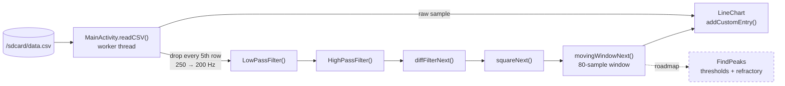

<p align="center"></p>

<p align="center">
  <a href="LICENSE"></a>
  
  
  <a href="https://www.robots.ox.ac.uk/~gari/teaching/cdt/A3/readings/ECG/Pan+Tompkins.pdf"></a>
  
  <a href="https://github.com/abhinav-adtechs/PanTompkins-Android/stargazers"></a>
  <a href="CONTRIBUTING.md"></a>
</p>

<p align="center"><b>The Pan–Tompkins QRS-detection front end (band-pass, derivative, squaring, moving-window integration) in plain Java, streaming an ECG through it live on an Android phone.</b></p>

<p align="center">
  <a href="#features">Features</a> ·
  <a href="#quick-start">Quick start</a> ·
  <a href="#architecture">Architecture</a> ·
  <a href="#docs">Docs</a> ·
  <a href="#roadmap">Roadmap</a> ·
  <a href="#contributing">Contributing</a>
</p>

> [!NOTE]
> **Status: classic project.** Built in July 2016 as a hands-on port of the 1985 Pan–Tompkins paper to Android, with a toolchain refresh in May 2019 (AGP 3.4.1, SDK 28). It is not actively maintained. The **preprocessing chain is complete**; the **decision stage** (adaptive thresholds, refractory period, search-back) is **not implemented yet**. See the [roadmap](#roadmap).

## Why PanTompkins-Android?

Pan and Tompkins' 1985 detector is the classic real-time QRS detector, but it is usually demonstrated offline, in MATLAB or Python over a whole recording. This project asks a simpler question: what does the signal look like at each stage when you run the algorithm **sample by sample on a phone**?

The app streams a recorded ECG from a CSV and pushes every sample through the paper's integer-coefficient filters. It plots the raw trace against the integrated energy envelope as it scrolls, and logs every intermediate value so you can check each stage against a reference implementation.

## Features

<table>
  <tr>
    <td width="50%" valign="top">
      <h3>🫀 Paper-faithful band-pass</h3>
      The low-pass recursion <code>y = 2y₁ − y₂ + x − 2x₆ + x₁₂</code> and the all-pass-minus-moving-average high-pass, ported from the paper's integer-coefficient design. Each uses a double-write ring buffer, so there is no modulo arithmetic per sample.
    </td>
    <td width="50%" valign="top">
      <h3>⚡ Streaming, one sample at a time</h3>
      Every stage is a stateful <code>…Next(double)</code>-style call on one <code>Filter</code> instance. There is no batch buffer and no look-ahead, so it can be dropped into any real-time loop.
    </td>
  </tr>
  <tr>
    <td valign="top">
      <h3>📉 Squaring + moving-window integration</h3>
      Squared output feeds an 80-sample moving-window integrator backed by a bounded <code>FixedQueue</code>. The result is the energy envelope the paper's thresholds operate on.
    </td>
    <td valign="top">
      <h3>📈 Live dual-trace chart</h3>
      MPAndroidChart <code>LineChart</code> in landscape: the raw ECG and the integrated envelope scroll together in a 600-sample window.
    </td>
  </tr>
  <tr>
    <td valign="top">
      <h3>⏱️ 250 → 200 Hz built in</h3>
      The paper's filters are tuned for 200 Hz. The reader drops every fifth row of a 250 Hz recording to match, and the sampling assumptions are <a href="docs/ALGORITHM.md#2-sampling-rate-assumptions">documented precisely</a>.
    </td>
    <td valign="top">
      <h3>🔬 Every stage on Logcat</h3>
      Each sample logs <code>lowVal</code>, <code>highVal</code>, <code>diffVal</code>, <code>sqVal</code> and <code>movingWindowVal</code>. Diff them against MATLAB/Python to validate your own implementation.
    </td>
  </tr>
</table>

> [!WARNING]
> **Known deviation:** the derivative stage never shifts its delay line, so at `HEAD` it outputs `−x/8 + 1/16` rather than a slope. The full analysis and a three-line fix are in [ALGORITHM.md §5](docs/ALGORITHM.md#5-stage-3-derivative).

## Tech stack

**Language & platform**
<br>


**Build**
<br>


**Libraries**
<br>


## Architecture



All five filter stages are methods on [`Filter`](app/src/main/java/io/medicaldev/pantompkinstesting/Filter.java). [`MainActivity`](app/src/main/java/io/medicaldev/pantompkinstesting/MainActivity.java) owns the reader thread and the chart. [`FindPeaks`](app/src/main/java/io/medicaldev/pantompkinstesting/FindPeaks.java) is a stub for the decision stage. The full module map, threading notes and build configuration are in [`docs/ARCHITECTURE.md`](docs/ARCHITECTURE.md).

## Quick start

**Prerequisites:** an Android Studio release that supports AGP 3.4.1 and Gradle 5.1.1 (the 3.4–3.6 line, from 2019), JDK 8, Android SDK Platform 28, and a device or emulator on API 19–28. An API 28 emulator is the path of least resistance.

1. **Clone**

   ```bash
   git clone https://github.com/abhinav-adtechs/PanTompkins-Android.git
   cd PanTompkins-Android
   ```

2. **Align the manifest package** (one line). The 2019 rename left the manifest and the Java sources in different packages, so `R` won't resolve. In `app/src/main/AndroidManifest.xml`:

   ```diff
   -    package="io.medicaldev.pantompkins">
   +    package="io.medicaldev.pantompkinstesting">
   ```

3. **Open in Android Studio** (_File › Open_, select the repo root) and let it sync. The repo ships `gradle-wrapper.properties` but no `gradlew` script. Android Studio's Gradle integration reads the distribution URL from that properties file, so it can sync without the script. The committed `local.properties` points at the original author's SDK path; Android Studio rewrites it for your machine.

4. **Prepare the input.** The app reads `/sdcard/data.csv`. Use one sample per line, with the ECG value in the first comma-separated column, **no header row**, recorded at **250 Hz**:

   ```text
   512
   515
   530
   ```

   ```bash
   adb push data.csv /sdcard/data.csv
   ```

5. **Grant storage access.** The app declares the permission but never asks for it at runtime:

   ```bash
   adb shell pm grant io.medicaldev.pantompkinstesting android.permission.READ_EXTERNAL_STORAGE
   ```

6. **Run** the `app` configuration. The chart starts scrolling once the reader thread opens the file.

> [!TIP]
> **Opening it in a modern Android Studio?** Expect to migrate the build. Point the wrapper at a current Gradle, bump AGP, and replace `jcenter()` with `mavenCentral()` (JitPack still hosts MPAndroidChart). Change `compile`/`testCompile` to `implementation`/`testImplementation`, run _Refactor › Migrate to AndroidX_, and move the package into a `namespace` in `app/build.gradle`. On Android 10+ devices, scoped storage may block the hard-coded `/sdcard` path. Loading the CSV through the Storage Access Framework or from `assets/` avoids that (both are on the roadmap).

<details>
<summary>Where do I get ECG data?</summary>

Any single-lead ECG exported as one numeric sample per line works. If your recording isn't 250 Hz, resample it to 250 Hz first. Alternatively, remove the every-fifth-row skip in `MainActivity.readCSV()` (L124–127) and resample to 200 Hz. Units don't matter to the filters, but the chart's left axis minimum is fixed at −20. Shipping a small, clearly-licensed sample file with the repo is a [roadmap](#roadmap) item.

</details>

## Usage: calling the filter chain from code

`Filter` is a plain Java class with no Android dependencies beyond an unused import. Create **one instance per signal** (it is stateful and not thread-safe) and call the stages in order for every sample at 200 Hz:

```java
package io.medicaldev.pantompkinstesting;   // your caller must live here: LowPassFilter/HighPassFilter are package-private

Filter filter = new Filter();               // the constructor MainActivity uses

for (double sample : ecgAt200Hz) {
    double lp  = filter.LowPassFilter(sample);   // y = 2y1 - y2 + x - 2x6 + x12, scaled by 1/32
    double hp  = filter.HighPassFilter(lp);      // x(n-15) - (1/32) * sum of last 32 samples
    double d   = filter.diffFilterNext(hp);      // see ALGORITHM.md §5 for the current behaviour
    double sq  = filter.squareNext(d);           // d * d
    double mwi = filter.movingWindowNext(sq);    // mean of the last 80 values
    // mwi is the integrated energy envelope; QRS complexes show up as broad lobes
}
```

| Method                     | Visibility      | Stage                                     | Where             |
| -------------------------- | --------------- | ----------------------------------------- | ----------------- |
| `Filter()`                 | `public`        | Constructor (seeds the derivative buffer) | `Filter.java` L39 |
| `LowPassFilter(double)`    | package-private | Low-pass, gain 36/32, 5-sample delay      | L94–106           |
| `HighPassFilter(double)`   | package-private | High-pass, 15-sample all-pass tap         | L108–117          |
| `diffFilterNext(double)`   | `public`        | Derivative (see warning above)            | L128–136          |
| `squareNext(double)`       | `public`        | Squaring                                  | L138–140          |
| `movingWindowNext(double)` | `public`        | Moving-window integration, N = 80         | L144–153          |
| `FixedQueue<E>(int limit)` | `public`        | Bounded queue used by the integrator      | `FixedQueue.java` |

> [!CAUTION]
> `lowPassNext()` and `highPassNext()` look like alternatives but are stateless scalar gains (×4.1114 and ×0.0145). Use `LowPassFilter()` and `HighPassFilter()`. Details are in [ALGORITHM.md §10](docs/ALGORITHM.md#10-legacy-and-unused-code-paths).

## Configuration

No environment variables or runtime settings. Everything is a constant in the source:

| Constant           | Value                                                     | Where                             |
| ------------------ | --------------------------------------------------------- | --------------------------------- |
| Input file         | `Environment.getExternalStorageDirectory() + "/data.csv"` | `MainActivity.java` L105          |
| Row decimation     | skip when `line_num % 5 == 0`                             | `MainActivity.java` L124–127      |
| Playback pacing    | `Thread.sleep(10)` per sample                             | `MainActivity.java` L148–152      |
| Integration window | `windowWidth = 80` samples                                | `Filter.java` L15                 |
| Chart window       | 600 visible points, left-axis min −20                     | `MainActivity.java` L57, L293–294 |

## Project structure

```text
PanTompkins-Android/
├── app/
│   ├── build.gradle                     # SDK 28, minSdk 19, MPAndroidChart v2.2.5
│   └── src/main/
│       ├── AndroidManifest.xml          # landscape MainActivity, storage permissions
│       ├── java/io/medicaldev/pantompkinstesting/
│       │   ├── Filter.java              # ★ the Pan–Tompkins preprocessing chain
│       │   ├── FixedQueue.java          # bounded queue behind the moving window
│       │   ├── FindPeaks.java           # stub for the decision stage
│       │   ├── MainActivity.java        # CSV reader thread + live dual-trace chart
│       │   ├── SampleMulti.java         # multi-series chart prototype
│       │   └── HeartyFilter.java        # third-party filter toolbox (CC BY-NC-SA 3.0, unused)
│       └── res/layout/activity_main.xml # one full-screen LineChart
├── build.gradle                         # AGP 3.4.1
├── gradle/wrapper/gradle-wrapper.properties  # Gradle 5.1.1
└── docs/
    ├── ALGORITHM.md                     # stage-by-stage maths with line references
    └── ARCHITECTURE.md                  # modules, threading, build config
```

## Docs

| Document                                           | What's inside                                                                                                                                                                                       |
| -------------------------------------------------- | --------------------------------------------------------------------------------------------------------------------------------------------------------------------------------------------------- |
| [`docs/ALGORITHM.md`](docs/ALGORITHM.md)           | Each filter's difference equation, how the Java implements it, verified cut-offs and delays, sampling-rate assumptions, and the paper's decision rules (thresholds, search-back, refractory period) |
| [`docs/ARCHITECTURE.md`](docs/ARCHITECTURE.md)     | Class map, runtime data flow, threading, build configuration, known build issue                                                                                                                     |
| [`CHANGELOG.md`](CHANGELOG.md)                     | Release history derived from the commit log                                                                                                                                                         |
| [`THIRD_PARTY_NOTICES.md`](THIRD_PARTY_NOTICES.md) | Licence of the bundled `HeartyFilter.java`                                                                                                                                                          |

## Roadmap

- [ ] Align `AndroidManifest.xml`'s `package` with the Java package so `HEAD` builds
- [ ] Fix the derivative stage so its delay line actually shifts
- [ ] Implement the decision stage in `FindPeaks`: adaptive thresholds, 200 ms refractory period, search-back, T-wave check
- [ ] Ship a small, clearly-licensed sample `data.csv` and document the input format
- [ ] Request storage permission at runtime, or load the CSV via the Storage Access Framework or `assets/`
- [ ] JVM unit tests for every filter stage (impulse responses, gains, delays)
- [ ] Migrate the build to current AGP/Gradle/AndroidX and stop tracking `local.properties` and `.idea/`
- [ ] Make the sampling rate and integration window explicit, configurable parameters

## Contributing

Issues and PRs are welcome, especially anything on the roadmap. Read [CONTRIBUTING.md](CONTRIBUTING.md) for setup, commit conventions and the PR checklist.

## License

MIT © 2016–2026 Abhinav Das. See [LICENSE](LICENSE).

`HeartyFilter.java` is third-party code under **CC BY-NC-SA 3.0** and is **not** covered by the MIT licence. See [THIRD_PARTY_NOTICES.md](THIRD_PARTY_NOTICES.md).

If you use this in research, please cite the original paper:

```bibtex
@article{pan1985realtime,
  author  = {Pan, Jiapu and Tompkins, Willis J.},
  title   = {A Real-Time {QRS} Detection Algorithm},
  journal = {IEEE Transactions on Biomedical Engineering},
  volume  = {BME-32},
  number  = {3},
  pages   = {230--236},
  year    = {1985},
  doi     = {10.1109/TBME.1985.325532}
}
```

## Star history

<a href="https://star-history.com/#abhinav-adtechs/PanTompkins-Android&Date"></a>

---

<p align="center">Built by <a href="https://github.com/abhinav-adtechs">Abhinav Das</a><br>If this project helped you, consider giving it a ⭐</p>
