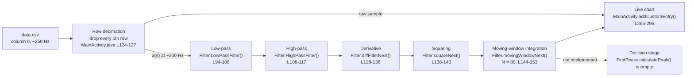

# The Pan–Tompkins pipeline, as implemented

This document walks through the signal chain in this repository **stage by stage, exactly as the Java code does it**, and compares each stage with the 1985 paper. Where the code departs from the paper, that is called out. Nothing here is aspirational: the decision stage (adaptive thresholds, refractory period, search-back) is **not implemented** in this repo, and [§9](#9-decision-stage-reference-only-not-implemented) is labelled as reference material.

All line numbers refer to `HEAD` (`55f5844`) and to files under
`app/src/main/java/io/medicaldev/pantompkinstesting/`.

## Contents

1. [Pipeline at a glance](#1-pipeline-at-a-glance)
2. [Sampling-rate assumptions](#2-sampling-rate-assumptions)
3. [Stage 1: low-pass filter](#3-stage-1-low-pass-filter)
4. [Stage 2: high-pass filter](#4-stage-2-high-pass-filter)
5. [Stage 3: derivative](#5-stage-3-derivative)
6. [Stage 4: squaring](#6-stage-4-squaring)
7. [Stage 5: moving-window integration](#7-stage-5-moving-window-integration)
8. [Display](#8-display)
9. [Decision stage (reference only, not implemented)](#9-decision-stage-reference-only-not-implemented)
10. [Legacy and unused code paths](#10-legacy-and-unused-code-paths)
11. [Checking the numbers yourself](#11-checking-the-numbers-yourself)
12. [Citation](#12-citation)

---

## 1. Pipeline at a glance



The live call site is the loop in `MainActivity.readCSV()` (L110–165). Per kept row it runs:

```java
lowVal        = filter.LowPassFilter(Double.parseDouble(item[0]));  // L128
highVal       = filter.HighPassFilter(lowVal);                      // L129
diffVal       = filter.diffFilterNext(highVal);                     // L133
sqVal         = filter.squareNext(diffVal);                         // L134
movingWindVal = filter.movingWindowNext(sqVal);                     // L135
```

One `Filter` instance holds all state for one signal (`MainActivity.java` L32: `new Filter()`).

## 2. Sampling-rate assumptions

The paper's integer-coefficient filters are designed for $f_s = 200$ Hz. This code gets there in a specific way:

| Where                             | What it does                                                           | Consequence                                                                                                                                      |
| --------------------------------- | ---------------------------------------------------------------------- | ------------------------------------------------------------------------------------------------------------------------------------------------ |
| `MainActivity.readCSV()` L124–127 | `line_num++; if (line_num % 5 == 0) continue;` drops rows 5, 10, 15, … | A 250 Hz recording becomes ~200 Hz on average (4 of every 5 samples). The commit that added this is titled _"retuned for sampling rate of 200"_. |
| same                              | No anti-alias filter before dropping                                   | The kept samples are **not uniformly spaced**: gaps go 4, 4, 4, 8 ms. That is a small timing jitter, not a true resample.                        |
| `Filter.java` L11                 | `private int samplingRate = 250;`                                      | Declared but never read. Nothing in the filters adapts to it.                                                                                    |
| `MainActivity.java` L148–152      | `Thread.sleep(10)` after each kept sample                              | Playback runs at ≤ 100 samples/s, roughly half of real time for a 200 Hz signal.                                                                 |

So the code assumes **the CSV is sampled at 250 Hz**. If your file is already 200 Hz, the row-dropping makes it 160 Hz and every cut-off frequency below shifts down by 20%.

Stage parameters at the assumed 200 Hz ($T = 5$ ms):

| Stage                          | Parameter in samples | At 200 Hz |
| ------------------------------ | -------------------- | --------- |
| Low-pass delay                 | 5                    | 25 ms     |
| High-pass delay                | 15 (all-pass tap)    | 75 ms     |
| Combined band-pass group delay | ≈ 20                 | ≈ 100 ms  |
| Moving-window width $N$        | 80                   | 400 ms    |

## 3. Stage 1: low-pass filter

**Code:** `Filter.LowPassFilter(double val)`, L94–106. **State:** `x[26]`, `n`, `y1`, `y2` (L24–25).

The paper's low-pass filter is a cascade of two 6-tap moving sums:

$$
H_{LP}(z) = \frac{\left(1 - z^{-6}\right)^{2}}{\left(1 - z^{-1}\right)^{2}}
$$

implemented as the recursion

$$
y(n) = 2\,y(n-1) - y(n-2) + x(n) - 2\,x(n-6) + x(n-12)
$$

The code matches it line for line (L97):

```java
y0 = (y1*2) - y2 + x[n] - (x[n +6]*2) + x[n +12];
y2 = y1;
y1 = y0;        // recursion keeps the UNSCALED value
y0 = y0/32;     // only the returned value is scaled
```

How the code does it:

- **Circular buffer without modulo.** `x` has 26 slots for a 13-sample history. Each new sample is written twice, `x[n] = x[n + 13] = val` (L96), and `n` counts _down_ from 12 to 0 (L101–102). So `x[n + 6]` and `x[n + 12]` are always the samples from 6 and 12 periods ago, with no wrap-around arithmetic.
- **Scaling.** The DC gain of $H_{LP}$ is $6^2 = 36$. The code divides the _output_ by 32 (L100) but feeds the unscaled value back into `y1`/`y2`, so the scaling never touches the recursion. Net DC gain: $36/32 = 1.125$.
- **Doubles, not ints.** The classic reference version works on integers and uses `>> 5`. Here everything is `double`, so `/32` is an exact division.

Verified properties (from simulating the Java code with an impulse):

- The impulse response is the triangle $\tfrac{1}{32}[1,2,3,4,5,6,5,4,3,2,1]$. It is symmetric, so the phase is linear and the delay is **5 samples** (25 ms at 200 Hz).
- −3 dB cut-off: **≈ 10.8 Hz** at 200 Hz (≈ 13.5 Hz if fed 250 Hz data directly). The paper gives about 11 Hz.

## 4. Stage 2: high-pass filter

**Code:** `Filter.HighPassFilter(double val)`, L108–117. **State:** `highx[66]`, `Highn`, `highy1` (L29–30).

The paper builds the high-pass filter as an all-pass delay minus a 32-sample moving average:

$$
y_1(n) = y_1(n-1) + x(n) - x(n-32)
$$

$$
y(n) = x(n-16) - \frac{y_1(n)}{32}
$$

The code (L110–116):

```java
highx[Highn] = highx[Highn + 33] = val;           // same double-write ring buffer, 33-sample history
highy0 = highy1 + highx[Highn] - highx[Highn + 32];
highy1 = highy0;
if(--Highn < 0) Highn = 32;                       // index decremented BEFORE the read below
return highx[Highn + 16] - (highy0/32);
```

Because `Highn` is decremented before `highx[Highn + 16]` is read, the all-pass tap is **$x(n-15)$**, not $x(n-16)$. What the code computes is:

$$
y(n) = x(n-15) - \frac{1}{32}\sum_{k=0}^{31} x(n-k)
$$

This makes no difference to the magnitude response. The 32-tap average is centred on $n - 15.5$, and taps 15 and 16 sit symmetrically around it, so both versions have the same |H|. Only the phase differs, by half a sample.

Verified properties (impulse simulation of the Java code):

- Unity gain at high frequency. −3 dB at **≈ 4.7 Hz** at 200 Hz. A mild bump of about 1.22× near 9 Hz.
- Combined with the low-pass, the band-pass response peaks at **≈ 8 Hz** (gain ≈ 1.11). Its −3 dB band is **≈ 4.9–11.8 Hz** at 200 Hz, with group delay ≈ 20 samples. The paper targets roughly 5–15 Hz, where QRS energy is concentrated.

## 5. Stage 3: derivative

**Code:** `Filter.diffFilterNext(double upVal)`, L128–136. **State:** `tempArrayX[5]` (L19), seeded in the no-arg constructor (L39–41).

The paper uses a five-point derivative:

$$
y(n) = \frac{1}{8T}\left[-x(n-2) - 2\,x(n-1) + 2\,x(n+1) + x(n+2)\right]
$$

Made causal (delayed by 2 samples) with $T = 1$, its taps are $\tfrac18[1, 2, 0, -2, -1]$. The coefficient array in the code (L14) holds the same values with the sign flipped:

```java
private static final double[] diffCoeff = {-0.1250, -0.2500, 0, 0.2500, 0.1250};
```

The sign doesn't matter, because the next stage squares the result.

> [!WARNING]
> **The delay line is never shifted.** `diffFilterNext` writes the newest sample into `tempArrayX[0]` (L129) and leaves elements 1–4 alone. The no-arg constructor seeds those four elements with `diffCoeff[0..3]` (L40: `System.arraycopy(diffCoeff, 0, tempArrayX, 1, diffCoeff.length-1)`), and they stay that way.

What actually runs, with `new Filter()` as `MainActivity` uses it:

$$
y(n) = -\tfrac{1}{8}\,x(n) + \left[\left(-\tfrac18\right)\left(-\tfrac14\right) + \left(-\tfrac14\right)(0) + (0)\left(\tfrac14\right) + \left(\tfrac14\right)\left(\tfrac18\right)\right] = -\tfrac{1}{8}\,x(n) + \tfrac{1}{16}
$$

With the other constructor, `Filter(double[])`, the seed is all zeros and the output is $-x(n)/8$.

This was confirmed by simulation: inputs `0, 1, 2, -3` produce `0.0625, -0.0625, -0.1875, 0.4375`.

The history points to the likely intent. When the buffer was introduced in `033d0a3` (*"optimized for real-time"*), the same `System.arraycopy(diffCoeff, 0, tempArrayX, 1, …)` ran inside `diffFilterNext` on **every call**. That reads like a shift whose source array should have been `tempArrayX`, not `diffCoeff`. A later commit moved it into the constructor.

**What this means:** the stage is a scale and offset of the band-passed signal, not a slope estimate. After squaring and integration, the envelope follows band-passed _energy_ rather than _slope energy_. QRS complexes still dominate it, because the band-pass already concentrates energy there. The paper uses slope information mainly to separate QRS from T waves.

A minimal fix (not applied; source is left as-is) is to shift the history before writing the new sample:

```java
public double diffFilterNext(double upVal){
    System.arraycopy(tempArrayX, 0, tempArrayX, 1, tempArrayX.length - 1);
    tempArrayX[0] = upVal;
    double mod = 0;
    for (int i = 0; i < diffCoeff.length; i++) mod += tempArrayX[i] * diffCoeff[i];
    return mod;
}
```

The constructor's seeding (L40) would also need to go, so the history starts at zero.

## 6. Stage 4: squaring

**Code:** `Filter.squareNext(double upVal)`, L138–140.

$$
y(n) = x(n)^2
$$

This is `Math.pow(upVal, 2)`. It makes every value positive and boosts large values more than small ones, as in the paper.

## 7. Stage 5: moving-window integration

**Code:** `Filter.movingWindowNext(double upVal)`, L144–153, backed by `FixedQueue<Double>` (L15–16; `FixedQueue.java` L15–21).

$$
y(n) = \frac{1}{N}\sum_{k=0}^{N-1} x(n-k), \qquad N = 80
$$

Implementation details:

- `FixedQueue.add()` appends the new value and evicts the oldest once the size exceeds `limit` (`FixedQueue.java` L17–19).
- The sum is recomputed from scratch on every call (L148–150), so each sample costs $O(N)$. A running sum would make it $O(1)$.
- During warm-up the code divides by the **current** queue size $m$, not by $N$ (L151):

$$
y(n) = \frac{1}{m}\sum_{k=0}^{m-1} x(n-k), \qquad m = \min(n+1,\,N)
$$

**Window width.** At 200 Hz, $N = 80$ is a **400 ms** window. The paper recommends about 150 ms (30 samples at 200 Hz). The history shows the value was tuned by hand: 38, then 30 in `e61661f` (matching the paper at 200 Hz), then 80 in `16d3a69`. The paper's guidance is that an overly wide window lets the QRS and T-wave energy merge into one lobe, and an overly narrow one splits a single QRS into several peaks.

## 8. Display

**Code:** `MainActivity.addCustomEntry(String ecgVal, double movingVal)`, L265–296.

- **Series 0** is the raw CSV value `item[0]` (`createSet()`, L358–372, colour `colorPrimaryDark` `#388E3C`). **Series 1** is the MWI output (`createSetB()`, L374–387, colour `colorAccent` `#FFC107`).
- The chart shows the latest 600 points and scrolls with the data (L293–294). `dataInit()` pre-fills 601 zero points so it starts out scrolled (L85–88).
- Both series share the left Y axis, whose minimum is fixed at −20 (L57). The raw ECG and the MWI envelope have very different magnitudes, so one of them may look flat depending on your data's units.
- Chart updates are made from the CSV worker thread (`feedMultiple()`, L99–108), not the UI thread.

## 9. Decision stage: reference only, not implemented

> [!IMPORTANT]
> `FindPeaks.java` is a scaffold. `calculatePeak()` is empty (L19–21). `peakFindingQueue` (44 samples, L10–11) and `currentMaxima` (L12) are declared but unused, and nothing constructs `FindPeaks`. **No QRS decisions, R-peak indices or heart rate are produced.** The rules below come from the paper and show what a full implementation would add on top of the MWI and band-pass outputs. They are tracked on the [roadmap](../README.md#roadmap).

The paper runs two parallel sets of thresholds: one on the integrated signal (subscript I) and one on the band-passed signal (subscript F). A peak is a local maximum. Each peak is classified as signal (QRS) or noise, and the running estimates update as follows.

Running peak estimates (shown for I; F is identical with SPKF/NPKF):

$$
\text{SPKI} \leftarrow 0.125\,\text{PEAKI} + 0.875\,\text{SPKI} \quad \text{(peak classified as QRS)}
$$

$$
\text{NPKI} \leftarrow 0.125\,\text{PEAKI} + 0.875\,\text{NPKI} \quad \text{(peak classified as noise)}
$$

Thresholds:

$$
\text{THRESHOLD}_{I1} = \text{NPKI} + 0.25\,(\text{SPKI} - \text{NPKI}), \qquad \text{THRESHOLD}_{I2} = 0.5\,\text{THRESHOLD}_{I1}
$$

**Search-back.** If no QRS is found within 166% of the current average RR interval, the highest peak since the last QRS that clears the _second_ threshold is taken as a QRS. In that case:

$$
\text{SPKI} \leftarrow 0.25\,\text{PEAKI} + 0.75\,\text{SPKI}
$$

**RR averages.** RR AVERAGE1 is the mean of the 8 most recent RR intervals:

$$
\text{RR}_{\text{AVG1}} = \tfrac{1}{8}\sum_{k=0}^{7} \text{RR}_{n-k}
$$

RR AVERAGE2 averages only the 8 most recent intervals that fell inside

$$
0.92\,\text{RR}_{\text{AVG2}} \;\le\; \text{RR} \;\le\; 1.16\,\text{RR}_{\text{AVG2}}
$$

The missed-beat limit is $1.66\,\text{RR}_{\text{AVG2}}$. When the rhythm is irregular, the paper halves the first thresholds to make detection more sensitive.

**Refractory period and T-wave discrimination:**

- No QRS can follow another within **200 ms** (40 samples at 200 Hz).
- A candidate between 200 ms and **360 ms** (72 samples) after the previous QRS is checked against the slope. If its maximum slope is less than half that of the previous QRS, it is treated as a T wave. This check needs a working derivative (see [§5](#5-stage-3-derivative)).

**Initialisation.** A short learning phase (2 s in the paper) seeds SPKI/NPKI and SPKF/NPKF before detection starts. A QRS is accepted only if it clears the thresholds on **both** the integrated and band-passed signals.

`HeartyFilter.PeakDetectionFilter` (`HeartyFilter.java` L319–410) is a local-maximum detector that could serve as a building block here. Note its non-commercial licence: see [`THIRD_PARTY_NOTICES.md`](../THIRD_PARTY_NOTICES.md).

## 10. Legacy and unused code paths

These are still in `Filter.java` but **not on the live path**:

| Member                                        | Lines    | What it actually does                                                                                                                          |
| --------------------------------------------- | -------- | ---------------------------------------------------------------------------------------------------------------------------------------------- |
| `lowPassNext(double)` / `lowPassNext(String)` | L74–91   | Returns `upVal × Σ lowPassCoeff` = `4.1114 × upVal`. Stateless, so it's a gain, not a filter.                                                  |
| `highPassNext(double)`                        | L119–126 | Returns `upVal × Σ highPassCoeff` = `0.0145 × upVal`. Same issue.                                                                              |
| `lowPassCoeff`, `highPassCoeff`               | L12–13   | Shaped like second-order-section rows `[b0 b1 b2 a0 a1 a2]` (a 2nd-order low-pass and a 2nd-order high-pass), but only ever summed as scalars. |
| `staticFilter()`                              | L50–63   | Batch loop over `currentECGReading` using the legacy methods. Its result `tempVar` is discarded.                                               |
| `movingWindowhandler()`, `queueInit()`        | L65–72   | Empty.                                                                                                                                         |

`MainActivity` switched from `lowPassNext`/`highPassNext` to `LowPassFilter`/`HighPassFilter` in commit `8c0d480` (_"Mods on High and low pass"_). The old call is still visible as a comment at L132.

`HeartyFilter.java` is a third-party filter collection from the _Hearty_ Android app (Savitzky–Golay, Hann, mean, peak/min detection, derivatives, window integrators). The live pipeline doesn't use it.

## 11. Checking the numbers yourself

- **Logcat.** `readCSV()` logs every stage for every sample (L144) with tag `Debug tag`. Because the tag contains a space, filter by message instead:

  ```bash
  adb logcat | grep "readCSV:"
  ```

  Each line prints `Value`, `lowVal`, `highVal`, `diffVal`, `sqVal` and `movingWindowVal`, which makes it easy to compare against a MATLAB/Python reference.

- **Offline.** `Filter` only uses plain Java arithmetic. Its `android.util.Log` import is unused, so the class can be exercised in a JVM unit test. The simulations quoted in this document (impulse responses, cut-offs, the derivative behaviour) were produced by re-implementing each method line for line and feeding it impulses and test vectors.

## 12. Citation

If you use this code or these notes, cite the original algorithm:

> J. Pan and W. J. Tompkins, "A Real-Time QRS Detection Algorithm," _IEEE Transactions on Biomedical Engineering_, vol. BME-32, no. 3, pp. 230–236, March 1985. doi: [10.1109/TBME.1985.325532](https://doi.org/10.1109/TBME.1985.325532)

```bibtex
@article{pan1985realtime,
  author  = {Pan, Jiapu and Tompkins, Willis J.},
  title   = {A Real-Time {QRS} Detection Algorithm},
  journal = {IEEE Transactions on Biomedical Engineering},
  volume  = {BME-32},
  number  = {3},
  pages   = {230--236},
  year    = {1985},
  doi     = {10.1109/TBME.1985.325532}
}
```

If you reuse `HeartyFilter.java`, its header requires citing:

> S. Gradl, P. Kugler, C. Lohmüller, and B. Eskofier, "Real-time ECG monitoring and arrhythmia detection using Android-based mobile devices," in _34th Annual International Conference of the IEEE EMBS_, 2012, pp. 2452–2455.
