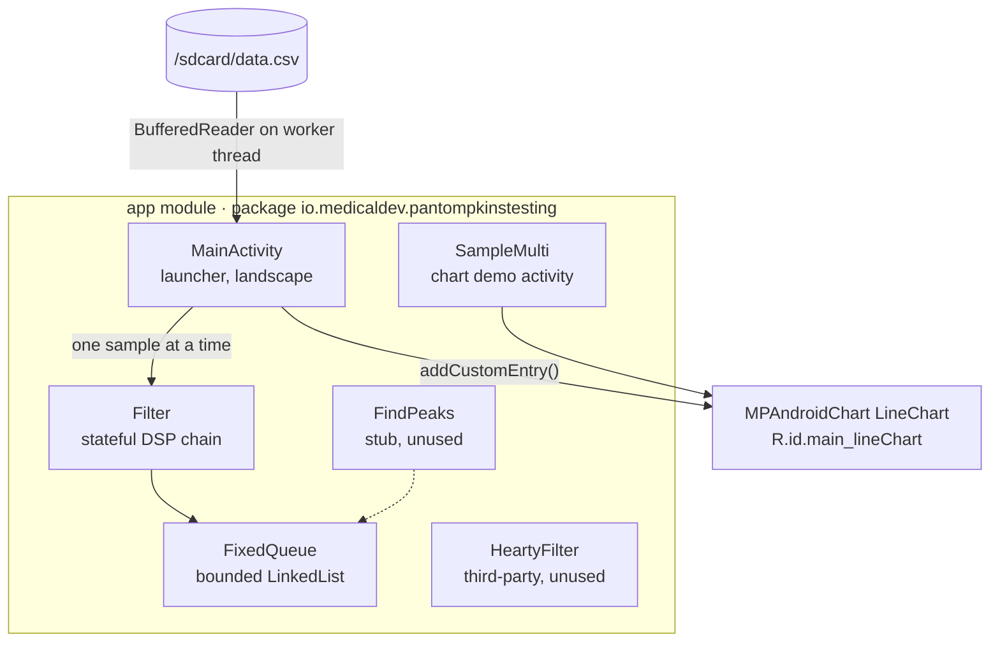
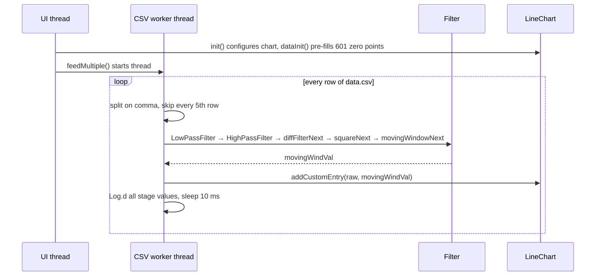

# Architecture

PanTompkins-Android is a single-module Android app with six Java classes. It has no services, database or network layer. One activity streams a CSV file from external storage, runs every sample through a stateful filter chain, and plots the result live.

For the maths of each filter stage, see [`ALGORITHM.md`](ALGORITHM.md).

## Module map

## Classes

| File                                                                                           | Role                                                                                                                                                                             | Notes                                                                                                                                                                                         |
| ---------------------------------------------------------------------------------------------- | -------------------------------------------------------------------------------------------------------------------------------------------------------------------------------- | --------------------------------------------------------------------------------------------------------------------------------------------------------------------------------------------- |
| [`MainActivity.java`](../app/src/main/java/io/medicaldev/pantompkinstesting/MainActivity.java) | Launcher activity, locked to landscape in the manifest. Sets up the chart, starts a worker thread that reads `data.csv`, runs the filter chain, and appends points to the chart. | Holds the single `Filter` instance (L32). The CSV loop is `readCSV()` (L110–165).                                                                                                             |
| [`Filter.java`](../app/src/main/java/io/medicaldev/pantompkinstesting/Filter.java)             | The Pan–Tompkins preprocessing chain: `LowPassFilter` → `HighPassFilter` → `diffFilterNext` → `squareNext` → `movingWindowNext`.                                                 | All state lives in instance fields, so use one instance per signal. Not thread-safe. Also contains unused legacy methods (see [ALGORITHM §10](ALGORITHM.md#10-legacy-and-unused-code-paths)). |
| [`FixedQueue.java`](../app/src/main/java/io/medicaldev/pantompkinstesting/FixedQueue.java)     | `LinkedList` subclass whose `add()` evicts the head once `size() > limit`.                                                                                                       | Backs the 80-sample moving window.                                                                                                                                                            |
| [`FindPeaks.java`](../app/src/main/java/io/medicaldev/pantompkinstesting/FindPeaks.java)       | Placeholder for the decision stage (thresholds, refractory period).                                                                                                              | `calculatePeak()` is empty. Never instantiated.                                                                                                                                               |
| [`SampleMulti.java`](../app/src/main/java/io/medicaldev/pantompkinstesting/SampleMulti.java)   | Small activity that adds three random series to a chart. It was used to prototype multi-line plotting (commit `35a73d5`).                                                        | Declared in the manifest without an intent filter, so it isn't reachable from the launcher.                                                                                                   |
| [`HeartyFilter.java`](../app/src/main/java/io/medicaldev/pantompkinstesting/HeartyFilter.java) | Third-party filter toolbox from the _Hearty_ app (Pattern Recognition Lab, University Erlangen-Nuremberg, 2012).                                                                         | **CC BY-NC-SA 3.0, not MIT.** Unused by the pipeline. See [`THIRD_PARTY_NOTICES.md`](../THIRD_PARTY_NOTICES.md).                                                                              |

## Runtime data flow

Notes on the flow:

- **Input path.** `Environment.getExternalStorageDirectory() + "/data.csv"` (`MainActivity.java` L105). Only column 0 of each row is used (L122, L128). There is no header handling: a non-numeric first row throws `NumberFormatException` on the worker thread.
- **Permissions.** The manifest declares `READ_EXTERNAL_STORAGE` and `WRITE_EXTERNAL_STORAGE`, but the app never requests them at runtime. With `targetSdkVersion 28`, you have to grant storage access yourself (see the README's Quick start). Without it, `FileNotFoundException` is caught and printed, and the chart stays flat. The repo's two historical issues ([#1](https://github.com/abhinav-adtechs/PanTompkins-Android/issues/1) "No Graph" and [#2](https://github.com/abhinav-adtechs/PanTompkins-Android/issues/2) "Data File missing") both trace back to this input step.
- **Threading.** Chart mutation and `notifyDataSetChanged()` run on the worker thread, not via `runOnUiThread`.
- **Timing.** `Thread.sleep(10)` per kept sample caps playback at about 100 samples/s.

## Build configuration

| Setting                                  | Value                                                                                                               | Source                                                   |
| ---------------------------------------- | ------------------------------------------------------------------------------------------------------------------- | -------------------------------------------------------- |
| Android Gradle Plugin                    | 3.4.1                                                                                                               | `build.gradle`                                           |
| Gradle wrapper                           | 5.1.1                                                                                                               | `gradle/wrapper/gradle-wrapper.properties`               |
| `compileSdkVersion` / `targetSdkVersion` | 28 / 28                                                                                                             | `app/build.gradle`                                       |
| `minSdkVersion`                          | 19                                                                                                                  | `app/build.gradle`                                       |
| `applicationId`                          | `io.medicaldev.pantompkinstesting`                                                                                  | `app/build.gradle`                                       |
| Manifest `package`                       | `io.medicaldev.pantompkins`                                                                                         | `app/src/main/AndroidManifest.xml` (mismatch, see below) |
| Repositories                             | `jcenter()`, `google()`, JitPack                                                                                    | `build.gradle`, `app/build.gradle`                       |
| Dependencies                             | `appcompat-v7:28.0.0`, `MPAndroidChart:v2.2.5`, `guava:18.0` (declared, not imported anywhere), `junit:4.12` (test) | `app/build.gradle`                                       |

> [!WARNING]
> **Package mismatch at `HEAD`.** The 2019 rename (`1e43b9f`) set the manifest `package` to `io.medicaldev.pantompkins`, but the Java sources live in `io.medicaldev.pantompkinstesting`. Under AGP 3.x, the generated `R` class follows the manifest package, and relative activity names (`.MainActivity`) resolve against it too. Expect `cannot find symbol: R` until the two match. Changing the manifest to `package="io.medicaldev.pantompkinstesting"` is the one-line fix (tracked on the roadmap).

## Repository hygiene

- `local.properties` (a machine-specific `sdk.dir`) and `.idea/` project files are committed. Android Studio regenerates `local.properties` for your machine. It is safe to overwrite locally, and it would ideally be untracked.
- There are no unit or instrumentation tests at `HEAD`. The template tests were removed in `55f5844`.

## History in one paragraph

The repo was built in ten days in July 2016 (package `io.cardeadev.pantompkinstesting`):

1. Filter scaffolding.
2. A streaming LineChart.
3. A high-pass filter and moving-window integration.
4. A two-series live chart.
5. On 9 July, the switch to the integer-coefficient Pan–Tompkins low/high-pass recursions.
6. A 200 Hz retune and a wider integration window.

In May 2019 the project was moved to the `io.medicaldev` namespace and upgraded to AGP 3.4.1, Gradle 5.1.1 and SDK 28. See [`CHANGELOG.md`](../CHANGELOG.md) for the commit-level record.
